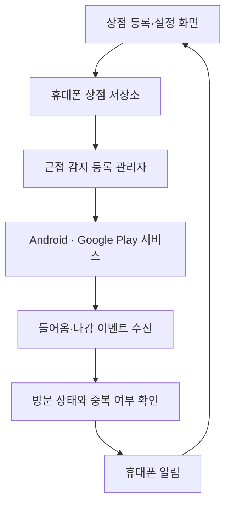

# 저장한 상점 근처 알림 앱 — 첫 버전 설계

- 작성일: 2026-10-10
- 프로젝트 이름: mapswork (임시)
- 상태: 사용자 검토용 설계안. 앱 구현과 휴대폰 검증은 아직 시작하지 않았다.

## 1. 만들려는 앱

사용자가 Android 앱에 상점 이름과 위치를 저장하면, 그 상점 근처에 갔을 때 휴대폰으로 알림을 받는다. 앱 화면을 닫거나 휴대폰을 잠근 상태에서도 Android가 허용하는 범위에서 동작한다.

### 사용자와 확인한 사항

- Android 휴대폰에서 사용한다.
- 첫 버전에서는 새 앱에 직접 등록한 장소를 대상으로 한다.
- 유료 저장소와 API 비용을 줄인다.
- 개발, 빌드, 자동 검증은 클라우드에서 진행한다.
- 완성된 전달 파일만 Mac 외장하드 M의 `공통작업` 폴더에 보관한다.

### 이 설계에서 정한 기본값

- 개인용 앱으로 시작한다. 로그인과 운영 서버가 필요 없는 구조를 사용한다.
- 상점 등록은 지도에서 위치를 찍고 이름을 입력하는 방식이다.
- 기본 알림 반경은 200m이며, 상점별로 100m / 200m / 500m / 1km를 선택할 수 있다.
- 같은 방문 중에는 알림을 반복하지 않는다. GPS 오차로 경계를 오갈 때를 위해 같은 상점 알림 사이에 최소 30분 간격을 둔다.
- Android 8.0 이상이며 Google Play 서비스가 있는 휴대폰을 지원 대상으로 한다.

위 기본값은 사용자가 직접 선택한 사항과 구분한 제안이다. 설계 검토에서 조정할 수 있다.

## 2. 기술 선택

| 방식 | 장점 | 고려할 점 |
| --- | --- | --- |
| **Kotlin으로 Android 앱 제작 — 추천** | 위치 권한, 근접 감지, 알림을 Android 기능과 직접 연결하기 쉽다 | 향후 iPhone 앱은 별도로 개발해야 한다 |
| React Native | 향후 다른 운영체제와 화면 코드를 공유하기 쉽다 | 백그라운드 위치 감지는 별도 네이티브 연동이 필요하다 |
| 웹앱 | 설치와 배포가 간단하다 | 화면을 닫은 상태에서의 지속적인 근접 알림에는 제약이 크다 |

첫 버전은 Kotlin과 Jetpack Compose로 화면을 만들고, Room으로 상점 정보를 휴대폰에 저장한다. Google Play 서비스의 Geofencing API로 근접 이벤트를 받고 Android 알림으로 안내한다.

지도는 MapLibre Android와 OpenStreetMap 지도를 이용한다. 개인용의 소규모, 대화형 지도 사용을 전제로 한다. 지도 데이터 출처를 화면에 표시하고, 타일 제공자의 캐시·요청 식별·사용 정책을 준수한다. 공개 타일 서버의 무제한 사용이나 서비스 가용성은 보장하지 않는다. 지도 제공 주소는 교체할 수 있게 분리한다.

## 3. 화면과 사용 순서

### 상점 목록

- 저장한 상점 이름, 반경, 알림 켜짐 여부를 표시한다.
- `상점 추가`로 등록 화면을 연다.
- 상점을 누르면 이름, 위치, 반경을 수정하거나 삭제할 수 있다.
- 상점별 알림 스위치를 제공한다.
- 상단에는 `알림 준비됨`, `위치 권한 필요`, `휴대폰 위치 사용 꺼짐` 등 실제 상태를 보여 준다.

### 상점 추가·수정

1. 지도를 이동하고 원하는 위치를 누른다.
2. 선택한 위치에 핀을 표시한다. 주소나 상점 이름 자동 검색은 첫 버전 범위에서 제외한다.
3. 상점 이름을 입력한다.
4. 알림 반경을 선택하고 저장한다.

`내 위치` 버튼은 화면에서 현재 위치를 한 번 요청하고 그 주변으로 지도를 이동한다. 위치 권한을 허용하지 않아도 지도를 이동해 장소를 등록할 수 있다. 저장한 장소의 알림은 권한을 설정한 뒤 활성화된다.

이름은 앞뒤 공백을 제거한 뒤 1~80자로 제한한다. 위도·경도와 반경을 검증한다. 같은 이름의 서로 다른 지점은 각각 저장할 수 있다.

지도를 불러오지 못하면 재시도 안내를 표시하고 입력한 이름과 선택 위치를 유지한다. 지도 로딩 실패가 기존 상점의 저장 정보나 알림 선택 상태를 삭제하지 않게 한다.

### 알림 설정 안내

- 앱 전체의 근접 알림을 켜고 끌 수 있다.
- 위치·백그라운드 위치·알림 권한과 휴대폰 위치 설정의 현재 상태를 보여 준다.
- 필요한 권한의 용도를 설명하고, 해당 Android 버전에 맞는 요청 또는 설정 화면으로 연결한다.
- 권한이 없으면 장소 저장은 가능하게 하고, 근접 알림이 준비되었다고 표시하지 않는다.
- 위치 정확도가 낮거나 배터리 제한으로 알림이 지연될 수 있으면 짧게 안내한다.

### 도착 알림

- 제목: `저장한 상점 근처에 도착했어요`
- 내용 예시: `○○카페 · 설정 반경 200m 안에 있어요`
- 알림을 누르면 해당 상점의 상세 화면을 연다.
- 삭제된 상점의 오래된 알림을 누르면 목록으로 돌아간다.

## 4. 위치 감지와 배터리 사용

Android가 제공하는 근접 감지 기능에 상점 좌표와 반경을 등록한다. 앱이 주기적으로 GPS를 조회하거나 이동 경로를 기록하는 방식은 사용하지 않는다. 등록 가능한 근접 감지 영역은 앱·사용자당 최대 100개이므로 첫 버전의 **동시에 알림을 켤 수 있는 장소 수를 100개**로 제한한다. 더 많은 장소는 알림을 끈 상태로 저장할 수 있다.

등록 시 이미 반경 안에 있다면 도착 알림을 받을 수 있다. 상점 이름만 수정할 때는 근접 감지 등록을 유지하고, 위치·반경·알림 상태를 바꾸면 등록을 갱신한다.

### 중복 알림 규칙

- 들어옴 이벤트에서 방문 상태가 `안에 있음`이면 추가 알림을 보내지 않는다.
- 나감 이벤트를 받으면 다음 방문을 받을 수 있는 상태로 바꾼다.
- 같은 상점의 마지막 알림으로부터 30분이 지나지 않았으면 새 알림을 억제한다.
- 억제된 알림을 30분 뒤에 자동으로 다시 보내지는 않는다. 다음 유효한 방문 이벤트를 기다린다.
- 마지막 알림 시각과 방문 상태는 휴대폰에 저장한다. 화면을 다시 열거나 같은 등록 요청을 반복해도 중복 알림을 만들지 않는다.
- 휴대폰을 끈 동안의 이동은 감지할 수 없다. 앱을 다시 열면 현재 위치를 한 번 확인해 저장된 방문 상태를 보정한다.

Android의 백그라운드 제한, 위치 정확도, Google Play 서비스, 제조사 배터리 설정에 따라 알림이 수 분 지연되거나 이벤트가 누락될 수 있다. 정확한 거리 경계에서 즉시 울리는 기능으로 안내하지 않는다. 첫 버전에는 상시 위치 추적 서비스나 지속적인 위치 업로드를 추가하지 않는다.

## 5. 앱 구성과 저장 정보

| 구성 | 역할 |
| --- | --- |
| Compose 화면과 ViewModel | 상점 목록·등록·상태 안내, 사용자 입력 처리 |
| Room 저장소 | 상점과 방문 상태 저장, 추가·수정·삭제 |
| 권한·기기 상태 확인 | 위치·알림 권한, 위치 설정, Google Play 서비스 사용 가능 여부 확인 |
| Geofencing 등록 관리자 | 사용자가 켠 상점을 시스템에 등록·해제하고 결과 기록 |
| 이벤트 수신기와 알림 처리 | 저장된 상태 확인, 중복 억제, 알림 전달 |
| 복구 작업 | 부팅·앱 업데이트 후 필요한 근접 감지 등록 재구성 |

상점마다 내부 ID, 이름, 위도, 경도, 반경, 알림 선택 상태, 생성·수정 시각을 저장한다. 방문 상태와 마지막 알림 시각도 상점 ID에 연결해 저장한다. 전체 알림 설정은 별도 설정 저장소에 둔다.

사용자의 `알림 켜기` 선택과 시스템의 `등록 성공` 상태를 구분한다. 등록 실패 시 선택을 잃지 않고 실패 원인을 화면에 표시한다. 활성화한 장소가 실제로 등록되기 전까지 `알림 준비됨`을 표시하지 않는다.

## 6. 권한과 복구 처리

- 먼저 화면에서 위치 권한을 요청하고, 백그라운드 알림을 켤 때 추가 권한을 설명한다.
- Android 10 이상의 백그라운드 위치와 Android 13 이상의 알림 권한은 운영체제별 흐름에 맞춰 처리한다.
- 정밀 위치를 허용하지 않으면 작은 반경의 근접 알림이 제대로 준비되지 않을 수 있음을 표시하고 설정을 안내한다.
- 전체 알림을 끄거나 상점을 삭제하면 해당 근접 감지 등록을 해제한다. 이미 전송 중인 이벤트도 저장된 최신 설정을 확인해 무시한다.
- 기기 재부팅·앱 업데이트 후에는 저장한 설정을 읽어 등록을 복구한다. 복구 작업은 권한과 Google Play 서비스 사용 가능 여부를 확인한다.
- 앱을 열거나 설정 화면에서 돌아올 때도 권한·기기 상태와 등록 상태를 다시 확인한다.
- 사용자가 Android 설정에서 앱을 강제 종료한 경우에는 앱을 다시 열기 전까지 알림을 기대할 수 없음을 사용 안내에 적는다.
- Google Play 서비스가 없는 기기, 위치 서비스가 꺼진 기기, 등록 실패 상태를 구분해 안내한다.

## 7. 정보 보관과 비용

상점과 방문 상태는 앱의 내부 저장 공간에 보관한다. 이동 경로를 기록하지 않으며 분석 SDK를 넣지 않는다. 첫 버전의 자동 클라우드 백업을 끄고, 앱을 삭제하면 등록한 장소도 삭제된다는 점을 안내한다.

지도 화면에서는 지도 타일 제공자에게 네트워크 요청이 전달된다. 이때 IP 주소와 열어 본 지도 영역이 제공자에게 전달될 수 있다. 이를 간단한 사용 안내에 포함한다.

첫 버전의 운영 서버·유료 장소 검색·유료 저장소 사용료는 없도록 구성한다. 지도 데이터 통신과 휴대폰의 일반 데이터 요금은 사용자의 통신 환경에 따른다. 향후 사용자 규모가 커지면 지도 제공 방식과 비용을 재검토한다.

Google 지도의 개인 저장 목록 가져오기와 Google Drive 백업은 이후 별도 기능으로 검토한다. 이번 앱의 개발이나 사용에 Drive 연결은 필수 조건이 아니다.

## 8. 검증 기준

### 클라우드에서 확인

- Android 앱 빌드가 성공하고 설치 가능한 APK가 생성된다.
- 자동 검사에서 권한 선언과 Android 구성 오류를 확인한다.
- 실제 이벤트 흐름에 의미 있는 단위 테스트를 실행한다: 첫 진입, 같은 방문의 반복 이벤트, 나감 뒤 재진입, 30분 제한, 꺼진·삭제된 상점 이벤트, 100개 활성화 한도.
- 실제 Geofencing API 연동은 기기 검증과 구분한다. 테스트 대역의 통과만으로 백그라운드 알림 성공을 주장하지 않는다.

### 실제 Android 휴대폰에서 확인

1. APK를 설치하고 상점을 등록한다. 앱을 다시 열어도 저장 정보가 유지된다.
2. 위치·백그라운드 위치·알림 권한을 설정하고 준비 상태를 확인한다.
3. 반경 밖에서 안으로 이동해 알림을 확인한다. 지도 핀·위치 정확도와 운영체제 지연을 고려해 시험한다.
4. 반경 안에 머무는 동안 알림이 반복되지 않는지 확인한다.
5. 반경 밖으로 나갔다가 30분 제한 이후 다시 들어가 새 알림을 확인한다.
6. 앱 화면을 닫고 휴대폰을 잠근 상태에서도 같은 시험을 진행한다.
7. 재부팅 후 복구, 알림 끄기·삭제, 권한 거부·철회 시 화면 상태를 확인한다.

클라우드만으로 확인하지 못한 항목은 전달 안내서에 `휴대폰 확인 필요`로 표시한다. 실제 시험 결과 없이 앱이 모든 기기에서 정상 작동한다고 표시하지 않는다.

## 9. 개발과 완성 파일 전달

코드 작성, 개발 도구, 의존성 다운로드, 빌드 캐시, 자동 검증은 클라우드에 둔다. Mac에서 Android Studio나 에뮬레이터를 실행할 필요가 없는 흐름을 사용한다. 실행 시험은 실제 Android 휴대폰에서 진행한다.

| 전달 파일 | 용도 |
| --- | --- |
| 개인 설치용 APK | Android 휴대폰에 설치 |
| 최종 소스 ZIP | 이후 수정·복구를 위한 보관 |
| 사용·검증 안내서 | 설치, 권한 설정, 실제 시험 결과와 남은 확인 항목 |

검증용 APK와 최종 배포 파일을 구분한다. 개인 설치용 APK는 서명하며, 이후 같은 앱을 업데이트하려면 같은 서명 키를 사용해야 한다. 서명 키나 OAuth 인증 정보를 공개 소스 ZIP에 넣지 않는다. 최종 배포 준비 단계에서 안전한 키 보관 방법을 확정한다.

외장하드에 저장할 위치는 **M → 공통작업 → mapswork**를 제안한다. Mac에서 실제 볼륨 이름이 `M`이면 예상 경로는 `/Volumes/M/공통작업/mapswork`이다. 이 경로의 실제 존재 여부는 클라우드에서 확인하지 않았다.

완성 파일을 클라우드에서 내려받아 위 폴더에 보관한다. 클라우드 작업 폴더를 외장하드에 상시 동기화할 필요가 없고, 현재 단계에서 M을 클라우드에 직접 연결할 필요도 없다.

## 10. 다음 단계

이 설계안을 검토한 뒤 파일 구성, 의존성 버전, 구현 순서, 검증 명령을 포함한 구현 계획을 작성한다. 계획 검토가 끝나면 클라우드에서 구현하고 전달 파일을 준비한다.

참고 문서:

- Android Geofencing: https://developer.android.com/develop/sensors-and-location/location/geofencing
- Android 백그라운드 위치: https://developer.android.com/develop/sensors-and-location/location/permissions/background
- OpenStreetMap 타일 사용 정책: https://operations.osmfoundation.org/policies/tiles/

설계 작성 시 Android Geofencing 문서와 OpenStreetMap 타일 사용 정책 접속은 클라우드 프록시의 403 응답으로 확인하지 못했다. 구현 단계에서 사용할 API·SDK 버전과 지도 사용 정책을 다시 확인해야 한다.
